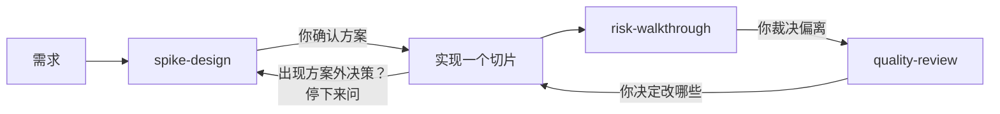

<div align="center">


# reins

**AI 负责奔跑，缰绳握在你手里。**

三个 Agent Skill，让编程助手始终走在你确认过的方案上：先定方案，按可追溯的切片实现，再逐条对照方案审查。

[](LICENSE)


**简体中文** · [English](README.en.md)


</div>

## 为什么

编程助手又快又强，但放任不管就会跑偏：

| 放任不管时，AI 会… | 有了 reins… |
|---|---|
| 加一个“以后可能用到”的接口 | 每个新增抽象都要进预算表，预算默认为 **0**，没有理由就删 |
| 引入没人要的库或缓存 | 每个新依赖在写代码**之前**就要说明为什么 |
| 悄悄在本地重建一份别的系统负责的数据 | 方案里写明**真源**，审查时第一个核对 |
| “顺手优化”一下，范围一点点扩散 | 方案外的决策会让 AI **停下来**，等你确认 |
| 自己审自己的代码，结论“看起来不错” | 审查从**方案对照**开始，由独立上下文完成 |

reins 不会让 AI 变慢或变笨，只是保证它的每一步都能追回到**你**做过的决定。

## 三个 skill

### 1 · `spike-design`：先方案，后代码

把需求、POC 或 spike 整理成真正能审的方案。你确认之前，**不写任何代码**。

- 目标、验收标准和明确的**非目标**
- 约束清单，涉及外部系统的结论标注“已实测 / 读代码 / 推断”
- **结构骨架**：新增模块、核心类型和接口签名
- **关键流程**：只写 3–5 处重难点，包括输入、步骤、失败时停在哪里、输出
- **抽象与依赖预算**，默认为 0
- 约 300 行一片的**切片计划**，每片的决策带编号（`S1-1`、`S1-2`…），实现和审查都按编号对照

### 2 · `risk-walkthrough`：只讲最需要人看的部分

代码太多没法逐行看，所以每个切片完成后，只讲需要人判断的地方，并列出偏离。

- 3–5 处重难点（事务、并发、鉴权、外部调用、状态流转），每处写不变量、失败后的状态和测试覆盖
- 偏离检查按顺序进行：**真源** → **骨架** → **预算** → 非目标 → 切片边界
- 每条偏离只能标“需要你决定”或“已在方案内”（附方案的文件和行号），没有中间状态

### 3 · `quality-review`：独立审查

审查者不知道代码是怎么写出来的。只报告，不修改。

- **先做方案对照**：diff 中每个决策对应到方案条目，对不上的标为“方案外”“与方案不符”或“未实现”
- 可读性、专业做法、**过度设计**、测试（“去掉这段逻辑，会有哪个测试失败？”）、数据与安全
- 问题按严重度排序，每条附 `文件:行号`、现在的写法和更简单或更专业的写法
- 小改动由主流程直接审，大改动交给独立上下文的 subagent。Java 的 [P3C](https://github.com/alibaba/p3c) 和 open-code-review 都是可选的，后者每次都要你同意才运行

<details>
<summary><b>输出长什么样</b></summary>

`risk-walkthrough` 最后列出待你决定的问题，用编号回复即可：

```markdown
## 偏离检查
- 真源：在 `PermissionMap.java:12` 本地重建了角色到权限的映射；
  方案规定由身份提供方负责（plan.md:41）→ 需要你决定
- 骨架：`RetryPolicy` 接口不在骨架中，且只有一个实现 → 需要你决定

## 待你决定
1. 删除本地权限映射，改为读取身份提供方的结果 → 推荐：是
2. 把 `RetryPolicy` 内联到客户端 → 推荐：是
```

`quality-review` 把方案对照放在最前面：

```markdown
## 方案对照
- 方案：docs/plans/export.md
- `ExportService.java:88` 方案外：超时后重试 3 次 → 最接近的条目：S2-3
- `S2-4` 未实现：导出没有限制在调用者所属租户内

## 严重问题（必须修）
- `ExportService.java:120` 全量读出后在内存里过滤 [来源：subagent]
  - 现在：`findAll().stream().filter(...)`
  - 建议：用带 `WHERE tenant_id = ?` 和分页的查询
```
</details>

## 快速开始

```bash
git clone https://github.com/Gamehu/reins.git ~/reins
```

把三个 skill 链接到所用工具的全局 skill 目录：

```bash
# Claude Code（OpenCode 也会读取这里）
mkdir -p ~/.claude/skills
for s in spike-design risk-walkthrough quality-review; do ln -s ~/reins/skills/$s ~/.claude/skills/$s; done

# Codex 和 OpenCode
mkdir -p ~/.agents/skills
for s in spike-design risk-walkthrough quality-review; do ln -s ~/reins/skills/$s ~/.agents/skills/$s; done
```

只想在某个项目里用，就链接到该项目的 `.claude/skills/` 或 `.agents/skills/`。以后 `git pull` 一次，所有工具同时更新。

## 怎么用



你说的话和 skill 的描述匹配时会自动触发，比如“先讨论方案”“review 一下”。在环节衔接处，直接点名更稳：

- **Claude Code**：`/spike-design`、`/risk-walkthrough`、`/quality-review`
- **Codex / OpenCode**：“用 spike-design 出方案”

建议在项目的 `CLAUDE.md` 或 `AGENTS.md` 里写明顺序：

```markdown
- 技术方案用 `spike-design` 产出；实现后用 `risk-walkthrough` 对照方案，再用 `quality-review` 审查。
```

## 原则

- **追溯决策，不追溯行。** 机械代码（组装、字段、转换、日志、测试）不需要写进方案；新的业务规则、数据来源、抽象、依赖、配置和失败策略必须写进方案。
- **预算为零。** 每个抽象和依赖都要说明为什么**现在**就需要，以及不加它代码会是什么样。
- **偏了不打补丁。** 切片的结构明显偏离骨架时，先修方案再重做切片；已写的代码丢不丢由你决定。
- **结论有来源。** 关于其他系统的结论注明来源；数字来自命令输出，不凭记忆。
- **语言不限。** skill 正文是中文，AI 用你对话的语言输出。

## 搭配 superpowers

需求本身还不清楚时，先用 [superpowers](https://github.com/obra/superpowers) 的 `brainstorming` 澄清；设计文档通过后进入 `spike-design`，不进入 `writing-plans`。`spike-design` 会直接采用文档里已有的目标、非目标和约束，只就缺口提问。

## 可选扩展

每个 skill 的核心部分只需要 Agent 本身。`quality-review` 还可以用到：

| 扩展 | 何时使用 | 要求 |
|---|---|---|
| **P3C**（阿里巴巴 Java 开发规约） | Java 改动 | 本机有 `java`。首次运行会下载 PMD 6.15.0、p3c-pmd 2.1.1 和 kotlin-stdlib 到 `~/.cache/p3c-check`（可用 `P3C_HOME` 覆盖），并按固定的 SHA-256 校验 |
| **open-code-review**（`ocr`，npm 包 `@alibaba-group/open-code-review`） | 每次都要你同意后才运行 | 大 diff 耗时长、token 消耗大，默认不运行 |

内置的语言规则覆盖 [Java](skills/quality-review/references/java.md) 和 [TypeScript](skills/quality-review/references/ts.md)，其他语言使用通用检查清单。项目自己的约定（`CLAUDE.md`、`AGENTS.md`、`CONTRIBUTING.md` 等）始终优先于内置规则。

## 常见问题

<details>
<summary><b>小改动也要走这么多流程吗？</b></summary>

流程会随规模缩小。小任务的方案很短；小改动由主流程直接审查，不起 subagent；找不到方案时只注明“无方案，未对照”，不阻断审查。
</details>

<details>
<summary><b>方案和代码要逐行对应吗？</b></summary>

不用。100 行的方案对应上千行代码很正常。只追溯决策，实现某个决策的代码都归到这个决策下。
</details>

<details>
<summary><b>它会自己修发现的问题吗？</b></summary>

不会。`risk-walkthrough` 和 `quality-review` 只报告。你按编号回复（如“1 接受，2 改”），AI 再更新方案或代码。
</details>

<details>
<summary><b>能看到 skill 实际是怎么跑的吗？</b></summary>

可以用 [skill-trace](https://github.com/Gamehu/skill-trace) 回放每一次 skill 运行：你提了什么、在哪里介入、最后交付了什么。
</details>

## 目录结构

```
skills/
  spike-design/SKILL.md
  risk-walkthrough/SKILL.md
  quality-review/
    SKILL.md
    references/        java.md、ts.md
    scripts/           p3c-check.sh、p3c-all.xml
docs/assets/           README 用到的图片
```

## 英文版

英文版在 [Gamehu/reins-en](https://github.com/Gamehu/reins-en)，规则先在本仓库修改，再同步过去。两个版本的 skill 同名，只装其中一个。

## 参与贡献

欢迎提 issue 和 pull request。请保持 skill 通用：规则里不写项目名、命令或特定工具的路径，也不规定输出语言。

## License

[MIT](LICENSE) © Gamehu
